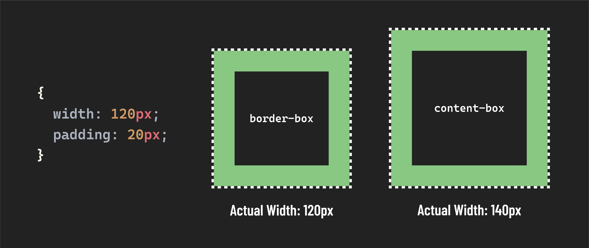

<h1>
  <span class="headline">Project Toolkit</span>
  <span class="subhead">Predictable Sizes</span>
</h1>


**Learning objective:** By the end of this lesson, students will understand what the `box-sizing` property is and how it works.

## What is `box-sizing`

`box-sizing` is a CSS property that allows us to control how the width and height of an element are calculated.

By default, when we specify an element's height and width, we are only setting the height and width of its content. However, when using the `border-box` value on the `box-sizing` property, any padding or border of the element is included in the calculation. Note, any margin is *not* included in `border-box`.



## Give the panel a width

Add these rules to `css/style.css`:

```css
.no-border-box {
  width: 320px;
  background-color: white;
}

.game-panel {
  width: 320px;
  background-color: white;
}
```

Our example box and panel both now have a content area that is `320px` wide.

The content is close to the edges. Add some space inside both:

```css
padding: 20px;
```

Add a visible border to each:

```css
border: 4px solid #0f766e;
```

## Notice the extra width

The panel’s content is still `320px` wide, but the padding and border have been added around it.

| Part | Width |
| --- | ---: |
| Content | 320px |
| Left and right padding | 40px |
| Left and right border | 8px |
| **Total visible width** | **368px** |

For this element’s default **`content-box`** sizing, `width` describes the content area **NOT** the total width of the element.


## Keep the padding inside the width

Add this declaration inside `.game-panel`:

```css
box-sizing: border-box;
```

The panel’s total width is now `320px`, including its padding and border. The content area becomes smaller to make room for them.

`border-box` changes how the browser calculates the box’s dimensions. **Margins remain outside the box.** [MDN](https://developer.mozilla.org/en-US/docs/Web/CSS/Reference/Properties/box-sizing?utm_source=chatgpt.com)

Our `.game-panel` rule should now look like this:

```css
.game-panel {
  width: 320px;
  padding: 20px;
  border: 4px solid #0f766e;
  background-color: white;
  box-sizing: border-box;
}
```

Imagine a UX designer provides you with a mock-up with specific measurements.Not using border-box can cause problems when we are trying to fit a panel, card, or form into a particular space.  

> 💡 This is especially useful for game boards, cards, and form fields. We can add comfortable spacing without repeatedly recalculating their total width.

## Why use `box-sizing: border-box`?

Most importantly, this rule makes sizing elements more intuitive - when setting the height or width of an element, that is the exact height or width that element will be. This makes writing CSS much more predictable.


<!-- Typically, we want to apply this setting to every element on the page, so we use the `*` selector to apply this style universally.

```css
* {
  box-sizing: border-box;
}
```

This is a fantastic rule to apply at the top of your stylesheets and is commonly used in CSS resets (we'll cover this more in the CSS Boilerplate lesson). Let's dive into why! -->

<!-- Because we've applied `box-sizing: border-box` universally, we can be sure that the height and width of any element on our page will always be calculated the same way. -->


<!-- ## 🎓 You Do

Change the panel’s padding to `30px`. Notice that its outside width stays the same while the space available for its content becomes smaller. Restore the padding to `20px` afterward. -->
