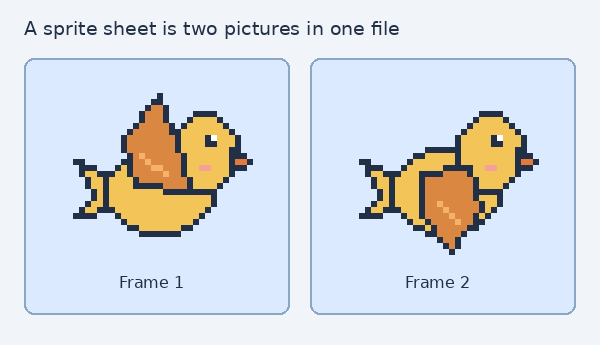

<h1>
  <span class="headline">Project Toolkit</span>
  <span class="subhead">Animate a Bird</span>
</h1>

**Learning objective:** By the end of this lesson, students will be able to use CSS keyframes to switch between two sprite frames.

## Create movement from still pictures

An animation changes something over time. Websites use animation for loading indicators, feedback, and decorative movement.

Our bird image contains two pictures:

- A bird with its wing raised.
- A bird with its wing lowered.

Each picture is a **frame**. The image containing both frames is a **sprite sheet**.



The supplied sheet is `128px` wide and `64px` tall. Each frame is `64px` by `64px`.

## Show one frame

We'll be using `bird-sprite-sheet.png` in `assets`.

Before `</main>`, add:

```html
<h2>Bird animation</h2>
<div class="bird-sprite"></div>
```

Give the element the dimensions of one frame:

```css
.bird-sprite {
  width: 64px;
  height: 64px;
}
```

Inside that rule, add:

```css
background-image: url('../assets/bird-sprite-sheet.png');
background-repeat: no-repeat;
background-position: 0 0;
```

The CSS file is inside `css`, so `..` moves up one folder before entering `assets`.

The element acts like a small window. It shows only the first `64px` of the wider image.

<!-- This bird is decorative. Any meaningful game information should also appear in text. -->

## Reveal the second frame manually

Replace the background position with:

```css
background-position: -64px 0;
```

The image moves one frame to the left. The second bird appears in the same window.

The element itself has not moved.

Restore:

```css
background-position: 0 0;
```

We now know how to show either frame.

## Describe the animation

Add this separate rule:

```css
@keyframes flap {
  from {
    background-position: 0 0;
  }

  to {
    background-position: -128px 0;
  }
}
```

**Keyframes** describe styles at points in an animation. `from` is the beginning, and `to` is the end. [developer.mozilla.org](https://developer.mozilla.org/en-US/docs/Web/CSS/Reference/At-rules/@keyframes)

`flap` is a name we chose. The ending distance is the width of the whole two-frame sheet.

Nothing uses these instructions yet.

## Connect the animation to the bird

Inside `.bird-sprite`, add:

```css
animation-name: flap;
animation-duration: 0.6s;
```

Refresh. The background moves once, but it slides between the pictures.

We want complete pictures to appear one after another.

Add:

```css
animation-timing-function: steps(2);
```

`steps(2)` divides the cycle into two intervals. The image stays at `0` for the first interval and `-64px` for the second. [MDN](https://developer.mozilla.org/en-US/docs/Web/CSS/Reference/Values/easing-function/steps)

Finally, add:

```css
animation-iteration-count: infinite;
```

The cycle now repeats.

`-128px` is the end boundary of each cycle. The next cycle immediately returns to the first frame.


## Keyframes resources

**Make your own artwork.** In [Piskel](https://www.piskelapp.com/), draw one **64px by 64px** frame, duplicate it, and change one detail in the second frame. Export a horizontal sprite sheet PNG with two frames and no space between them. Save it as `bird-sprite-sheet.png` in your `assets` folder. Because the frame sizes and count match, the same CSS can animate your new picture.

For more free game art, explore [Kenney's platformer sprites](https://kenney.nl/assets/new-platformer-pack). Check a sprite sheet's frame size before using it: other sheets may need different CSS numbers.
